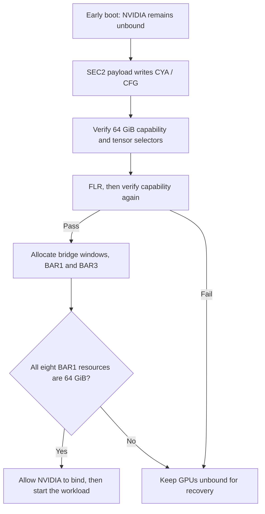

# RTX 4090 — 64 GiB BAR1

This fork enables a **64 GiB PCIe BAR1 aperture** on selected RTX 4090 cards
(`10de:2684`, AD102), before the NVIDIA driver starts. It has been validated on
eight RTX 4090 cards with 48 GiB of physical VRAM.

BAR1 is the PCIe address window used to map GPU memory. Increasing it to 64 GiB
allows the 48 GiB framebuffer to fit within the aperture; physical VRAM capacity
stays the same. The existing Tensor Core FP32-accumulate unlock is retained.

See the [BAR1 implementation and validation report](docs/bar1-64g-report.md)
for the register changes, allocation layout and application results.

## What changes

There are two separate steps:

1. **Expose the GPU capability.** The existing SEC2 high-privilege payload writes
   CYA (`0x88724 = 0x30`) and CFG (`0x88dcc = 0x8000000a`), then opens XVE and
   FEAT. The module checks the payload marker, SEC2 HALT and register readbacks,
   performs Function Level Reset (FLR), and verifies that 64 GiB support survives.
   Host-side CYA/CFG writes alone were ignored on the tested cards.
2. **Allocate the address space.** Linux must assign a 64 GiB BAR1 resource and
   the upstream PCIe bridges must route it. Advertising 64 GiB support alone
   does not resize those resources. A separate, topology-specific helper handles
   bridge packing where the normal resize path returns `ENOSPC`.



These changes do not require PCIe link retraining, a VBIOS flash or an additional
BAR1 patch to the NVIDIA driver. The early-boot sequence reapplies the settings
on subsequent boots.

## Verified results

The eight-card test used Linux `7.0.0-38-generic` and NVIDIA open P2P `615.71.09`.

| Check | Result |
| --- | --- |
| Advertised BAR1 maximum | 32 GiB → 64 GiB |
| Linux-assigned BAR1 | 64 GiB on all eight GPUs |
| NVIDIA BAR1 total | 65536 MiB on all eight GPUs |
| BAR1 actually used under load | Approximately 46.8 GiB per GPU |
| Ordinary reboot from the default boot entry | Eight-card configuration restored |
| DeepSeek TP8 vLLM acceptance | Both request sets completed 32/32, zero failures |
| Workload recovery after reboot | Container restarted automatically; local and external chat passed |

The vLLM checks used 512/128 and 4096/256 input/output token workloads with client
concurrency 8. These are functional acceptance results; no matched 32 GiB BAR1
performance comparison was run. The Tensor Core selectors also passed their
post-FLR checks; isolated tensor throughput was not remeasured in this test.

## Scope

The BAR1 payload is selected only for RTX 4090 `10de:2684`. Other GPU IDs retain
their existing payloads. Enabling the module still requires an explicit target
selection; the BAR1 option defaults to on only for selected RTX 4090 cards.

The optional bridge-layout helper under [tools/](tools/) was validated for a
specific four-GPU switch topology. It assigns a 128 GiB window per populated
port to fit an aligned 64 GiB BAR1 and BAR3, with a 576 GiB upstream window per
four-card group. **Adapt its topology checks and boot integration before using
it on another system.** It is separate from the general module packages.

The upstream GA10x tensor-unlock support, including the
[GA107 RTX 3050 6GB path](docs/ga107-2584-report.md), and explicitly gated
experimental Ada targets remain available. They do not gain this BAR1 modification.
Tensor measurements are documented in the
[RTX 4090 report](rtx4090-register-report.md),
[matched RTX 4090 evidence](docs/evidence/rtx4090-pr1-matched/README.md) and
[RTX 4070 Ti SUPER report](docs/ada-2705-report.md).

<details>
<summary>Upstream experimental tensor-unlock targets</summary>

### Experimental Ada targets

Each ID below needs its own opt-in flag. Rows marked *exact* must also be
named by their exact PCI address in `gpu_unlock.targets=`, alone or in a
comma-separated list, and `targets=all` never selects them. All of them use the RTX 4090's pinned
AD102-family firmware and payload. Results come from one or a few cards per ID;
other boards, memory configurations and laptop models remain unverified.
`tools/print_boot_option.py` prints the exact option for any card listed here.

| PCI ID | Card | Die | Opt-in | Tested | Details |
|---|---|---|---|---|---|
| `2685` | RTX 4090 D | AD102 | `rtx4090d_experimental` | eight cards in one host | [#7](https://github.com/JustAResearcher/gpu-unlock-ada/pull/7) |
| `2689` | RTX 4070 Ti SUPER | AD102 | `rtx4070tis_ad102_experimental`, exact | one card, 30-minute soak | [#19](https://github.com/JustAResearcher/gpu-unlock-ada/pull/19) |
| `2702` | RTX 4080 SUPER | AD103 | `ad103_experimental`, exact | one card, matched mma and cuBLAS, alongside a 2704 in one host | [matched evidence](docs/evidence/ada2702-ada2704-matched/README.md), [#53](https://github.com/JustAResearcher/gpu-unlock-ada/issues/53) |
| `2704` | RTX 4080 | AD103 | `rtx4080_experimental`, exact | one modified 32 GiB card; a second card in [matched evidence](docs/evidence/ada2702-ada2704-matched/README.md) | [report](docs/rtx4080-hardware-report.md) |
| `2705` | RTX 4070 Ti SUPER | AD103 | `ad103_experimental`, exact | one card, matched stock/unlocked | [report](docs/ada-2705-report.md) |
| `2709` | RTX 4070 | AD103 | `ad103_experimental`, exact | one card, matched | [report](docs/ada-2709-report.md) |
| `2757` | RTX 4090 Laptop GPU | AD103M | `ad103m_experimental`, exact | Clevo: unlocked, no throughput change; Lenovo: 2× on two cold boots | [report](docs/ada-2757-report.md), [Lenovo](https://github.com/JustAResearcher/gpu-unlock-ada/issues/4#issuecomment-6397961415) |
| `2782` | RTX 4070 Ti | AD104 | `ad104_experimental`, exact | one card in a VFIO guest, matched; one bare-metal owner report | [report](docs/ada-2782-report.md), [#15](https://github.com/JustAResearcher/gpu-unlock-ada/pull/15) |
| `2783` | RTX 4070 SUPER | AD104 | `ad104_experimental`, exact | one card, matched | [report](docs/ada-2783-report.md) |
| `2786` | RTX 4070 | AD104 | `ad104_experimental`, exact | one card; three owner reports | [report](docs/ada-2786-report.md), [#11](https://github.com/JustAResearcher/gpu-unlock-ada/pull/11) |
| `2803` | RTX 4060 Ti | AD106 | `ad106_experimental`, exact | one 16 GB card, matched; two more boards in #34 | [report](docs/ada-2803-report.md), [#34](https://github.com/JustAResearcher/gpu-unlock-ada/pull/34) |
| `2805` | RTX 4060 Ti 16GB | AD106 | `ad106_experimental`, exact | one card, no matched throughput run | [report](docs/ada-2805-report.md) |
| `2882` | RTX 4060 | AD107 | `ad107_experimental`, exact | one card, matched cuBLAS; cold boot and warm reboot | [report](docs/ada-2882-report.md) |
| `28a0` | RTX 4060 Laptop GPU | AD107 | `ad107_experimental`, exact | one card, unlocked state only | [report](docs/ada-28a0-report.md) |
| `28e0` | RTX 4060 Laptop GPU | AD107 | `ad107_experimental`, exact | one owner report | [#10](https://github.com/JustAResearcher/gpu-unlock-ada/pull/10) |
| `28e1` | RTX 4050 Laptop GPU | AD107 | `ad107_experimental`, exact | one laptop, matched | [report](docs/ada-28e1-report.md) |

Laptops differ in VBIOS ROM exposure, embedded-controller power rails and FLR
handling, so a result on one model does not carry over to another. Other Ada
IDs, professional RTX A-series and data-centre parts are not accepted. Shared
firmware across Ada chips does not establish support for untested cards.

</details>

## Related reading

- [64 GiB BAR1 on RTX 4090 48G](http://aajax.top/2026/10/25/64GigabyteBAR1on409048G/)
  — companion write-up, in preparation.
- [给 48G 魔改 4090 解锁 PCIe P2P：动态 BAR1 映射的实现](https://duanyll.com/2026/7/13/4090-48G-P2P/)
  — background on the 32 GiB aperture limit and prior work on per-allocation
  dynamic BAR1 mappings in the driver.

## Build and install

Build the GPL-2.0-only source locally so the pinned NVIDIA inputs are downloaded,
verified and converted into firmware assets on your machine:

```sh
git clone https://github.com/84634E1A607A/gpu-unlock-4090-48g-64g-bar1.git
cd gpu-unlock-4090-48g-64g-bar1
make install
```

`make install` detects the supported distribution family. Explicit targets are:

```sh
make install-arch   # makepkg -sif
make install-deb    # apt-get build-dep, dpkg-buildpackage, apt-get install
make install-rpm    # dnf builddep, rpmbuild, dnf install
```

`make arch`, `make deb` and `make rpm` build without installing. Packages use the
committed `HEAD`; Debian and RPM outputs go to `build/deb` and `build/rpm`.
Kernel headers and a working DKMS toolchain are required.

Builds verify the SHA-256 hashes of the pinned NVIDIA `610.43.03` inputs.
`make inputs` prepares the cache, `make firmware` generates assets from cached
inputs, and `make assets` does both. The default cache is
`$HOME/.cache/gpu-unlock`; override it with `CACHE=`, `INPUTS=` or `ASSETS=`.
Clean-chroot Debian builds require `GPU_UNLOCK_INPUTS` to point to that cache.

Source archives contain no NVIDIA archives or generated firmware. See
[firmware/README.md](firmware/README.md) for asset generation and
[QUICKSTART.md](QUICKSTART.md) for the underlying module build workflow.

## Enable at boot

The module and firmware must be present in the initramfs and execute before
NVIDIA binds the selected cards. Select targets through the kernel command line:

```text
gpu_unlock.targets=0000:03:00.0
gpu_unlock.targets=all
```

The PCI address is an example; use the full address reported by `lspci -D`.
`all` also selects accepted legacy GA10x cards. Experimental Ada targets require
their opt-in flag from the [table above](#experimental-ada-targets). IDs marked
*exact* must be listed by PCI address, alone or in a comma-separated list;
`all` never selects those IDs.

For selected RTX 4090 cards, `gpu_unlock.bar1_64g=1` is the default.
`gpu_unlock.bar1_64g=0` selects the original tensor-only payload.

General packages provide these initramfs integrations:

- **mkinitcpio:** `/etc/mkinitcpio.conf.d/zz-gpu-unlock.conf` places `gpu_unlock`
  before `nvidia`. Custom configurations selected with `-c` or a preset require
  the same ordering explicitly.
- **initramfs-tools:** `/usr/share/initramfs-tools/modules.d/gpu-unlock.conf`.
- **dracut:** `/usr/lib/dracut/dracut.conf.d/gpu-unlock.conf`.

For the validated eight-card layout, a separate early-boot script holds the
GPUs unbound, waits for all unlock transactions, assigns both groups of bridge
resources, and releases the cards only when all eight BAR1 resources are 64 GiB.
The general package install does not configure this topology-specific step.
See the [BAR1 report](docs/bar1-64g-report.md) for that deployment sequence.

Use a cold power-on for the first attempt. Ordinary reboot worked on the tested
eight-card system, but other boards may retain initialized firmware state.
The module refuses to rerun when WPR2 is already enabled and skips cards that
are bound or powered down. If board firmware left bus mastering enabled, the
module clears it and verifies that it stayed cleared. Loading it after NVIDIA
binds cannot perform the unlock.

After validating both initial boot and ordinary reboot, make the tested
bootloader entry persistent. Keep an original system entry available. Custom
kernel-version-specific initrds must be rebuilt and revalidated when upgrading
their kernel. Display handoff was not part of the BAR1 acceptance test.

## Check and disable

Check each of these independently:

1. Kernel logs show `gpu_unlock: unlocked` and successful post-FLR checks.
2. The supported-size mask includes 64 GiB, and the Linux BAR1 resource is
   actually 68719476736 bytes.
3. `nvidia-smi -q -d MEMORY` reports BAR1 total of 65536 MiB for every selected GPU.
4. The real workload runs without GPU or PCIe errors.

```sh
journalctl -k -b | grep -E 'gpu_unlock|BAR1'
lspci -vv -s 0000:03:00.0  # replace the example address
nvidia-smi -q -d MEMORY
```

A loaded module or an advertised 64 GiB maximum alone does not establish that
the driver received a usable 64 GiB mapping.

Remove `gpu_unlock.targets=` to disable future unlock attempts. On a dedicated
64 GiB boot image that requires all eight cards to pass, use the original system
entry for rollback; changing only `bar1_64g=0` will not satisfy that image's guard.
Power off to restore fresh hardware state. If the module reports retained DMA
buffers because firmware did not stop, power off before retrying and do not
force-unload the module.

## Development and credits

`make test` runs host-side tests without accessing a GPU. With generated firmware,
it also exercises full transactions against mocked hardware. Missing firmware or
source coverage is reported as skipped; `make test-full` requires the pinned inputs.
See the [testing guide](docs/testing.md) for full host validation and hardware checks.
The kernel verifies each loaded asset against its pinned SHA-256 before claiming
the card or starting firmware DMA, including assets staged into an initramfs.
The kernel's SHA-256 library (`CONFIG_CRYPTO_LIB_SHA256`) must be available.
`make LLVM=1 -C kernel/gpu_unlock` builds with LLVM against the running kernel's
headers.

The Linux module and packaging derive from
[Zagitta/gpu-unlock](https://github.com/Zagitta/gpu-unlock). The AD102 payload and
published debug-booter analysis derive from
[TOTORONG/AD103_win_unlocker](https://huggingface.co/TOTORONG/AD103_win_unlocker),
integrated by [JustAResearcher/gpu-unlock-ada](https://github.com/JustAResearcher/gpu-unlock-ada).
The BAR1 variant reuses that chain with the four write arguments documented in
the [BAR1 report](docs/bar1-64g-report.md). The GA102 V67 chain derives from
[WildFlash1st/cmp90hx-unlock](https://github.com/WildFlash1st/cmp90hx-unlock).
NVIDIA's published loader code, Nouveau and
[envytools](https://github.com/envytools/envytools) also underpin the loader.

The kernel module, packaging and payload integration are GPL-2.0-only. NVIDIA
firmware remains under its own terms. See [firmware/NOTICE.md](firmware/NOTICE.md)
and [licenses/](licenses/) for provenance and preserved license notices.
